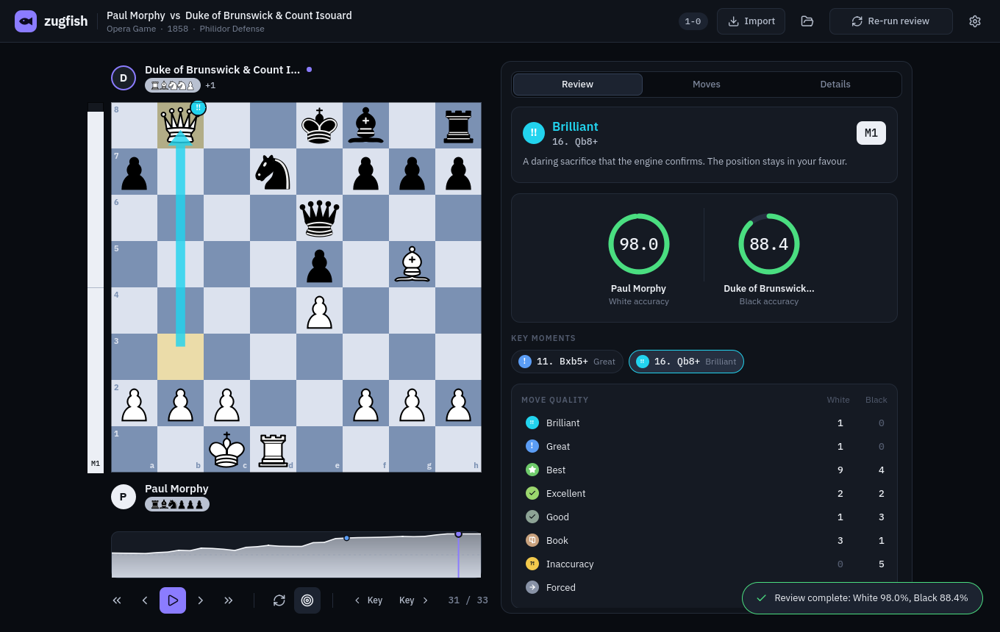
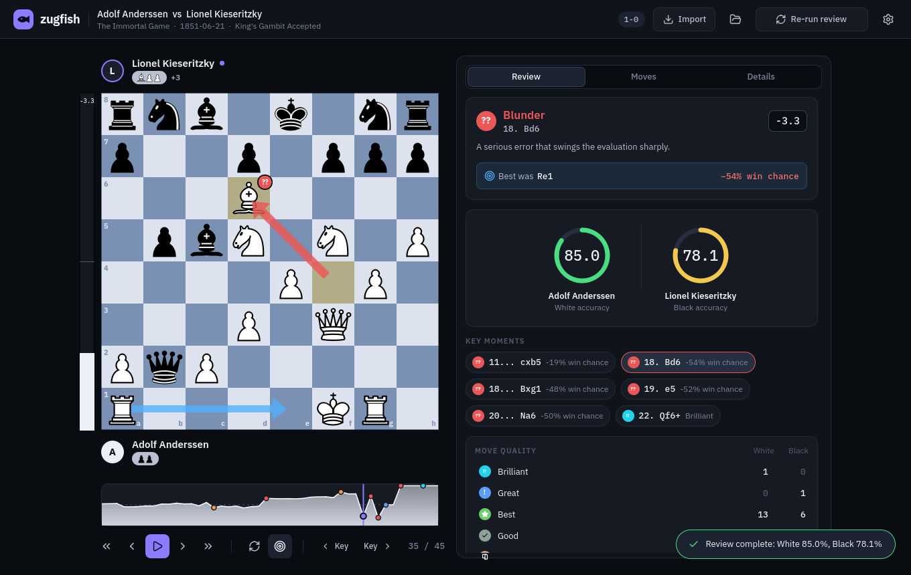

# zugfish (Qt Quick front end)

A fast, dark, keyboard-friendly review UI for chess games: board with animated moves and
engine arrows, advantage bar and graph, per-move quality badges, accuracy rings, key moments,
full move list, Chess.com / Lichess import, drag-and-drop PGN.




It is **only the UI**. All chess and engine work sits behind one small interface
(`src/backend/IBackend.h`), so the front end runs on its own with bundled demo reviews, and
switches to your real zugfish core with a single CMake flag.

## Build and run (Arch Linux)

```sh
sudo pacman -S --needed base-devel cmake ninja qt6-base qt6-declarative qt6-svg qt6-wayland stockfish
cmake -B build -G Ninja -DCMAKE_BUILD_TYPE=Release
cmake --build build
./build/zugfish-qt
```

Out of the box this runs in **demo mode**: three famous games (Opera Game, Immortal Game,
Legal's Mate) with real Stockfish reviews baked in, so every screen is exercised. In demo mode
PGN paste/import only understands those bundled games.

## Use your real zugfish core

```sh
cmake -B build -G Ninja -DCMAKE_BUILD_TYPE=Release -DZUGFISH_CORE_DIR=$HOME/.coding/zugfish
cmake --build build
```

`ZUGFISH_CORE_DIR` must contain `core/*.cpp`, `core/zugfish.hpp` and `third_party/chess.hpp`
(the same layout as your CLI project). It also needs libcurl and nlohmann-json
(`pacman -S curl nlohmann-json`).

**The only file that touches your core is `src/backend/ZugfishBackend.cpp`** (about 150
lines). I wrote it against the API your ImGui `main.cpp` used (`parse_pgn`,
`GameReviewer::review`, `OnlineImporter::fetch_recent_games`, `AnalyzedPly`, ...) and
compile-checked it against a stub of that API (`tools/zugfish_stub/`), but I have not seen
your headers. If a name differs, the compiler will point at the exact line.

## Architecture

```
qml/*.qml  ──►  AppController (App)  ──►  IBackend
 (pure UI)      state, navigation,         ├─ DemoBackend      bundled data, no engine
                settings, worker threads  └─ ZugfishBackend   your core (-DZUGFISH_CORE_DIR)
```

| Piece | Role |
|---|---|
| `src/AppController.*` | The one object QML sees (`App`). Position, review results, navigation, settings, threads. |
| `src/PlyModel.*`, `OnlineGamesModel.*` | List models for the move list and the import dialog. |
| `src/ReviewTypes.h` | Plain data types shared with backends. |
| `qml/Theme.qml` | **Every colour, size and radius.** Restyle the app here. |
| `qml/ChessBoard.qml` | Board, SVG pieces, last-move highlight, slide animation, arrows, badges. |
| `qml/EvalBar/EvalGraph/AccuracyRing.qml` | Advantage bar, scrubbable graph, accuracy gauges. |
| `qml/ReviewPanel/MovesPanel/DetailsPanel.qml` | The three tabs. |

The review runs on a worker thread and reports progress through queued signals; QML never
blocks. The core stays free of Qt, so a different UI could sit on the same backend.

## Keys

`←` `→` step · `Home` `End` · `Space` play/pause · `F` flip · `K` / `J` next / previous key
moment · `R` run review · `Ctrl+O` open file · `Ctrl+I` import · `Ctrl+V` paste PGN ·
`Ctrl+,` settings · mouse wheel over the board steps through the game.

## Developer options

```sh
./build/zugfish-qt --sample opera --review --ply 31      # jump straight to a state
./build/zugfish-qt --dialog settings --size 1040x680
QT_QPA_PLATFORM=offscreen QT_QUICK_BACKEND=software tools/screenshots.sh   # headless screenshots
```

`tools/gen_demo.py` regenerates `data/demo_games.json` with your own Stockfish.

## Notes

* Tested with Qt 6.4.2 (the oldest supported) and builds as written on newer Qt. On Qt before
  6.5 the experimental ahead-of-time QML compiler is switched off in `CMakeLists.txt`,
  because it hung on this UI there.
* Platforms: the UI is portable (Linux, Windows, macOS). The process-spawning code in your
  core (`fork`/`pipe`) is POSIX-only, so Windows needs that one piece ported.
* Licences: see `THIRD_PARTY.md`. The bundled piece set is GPLv2+.
